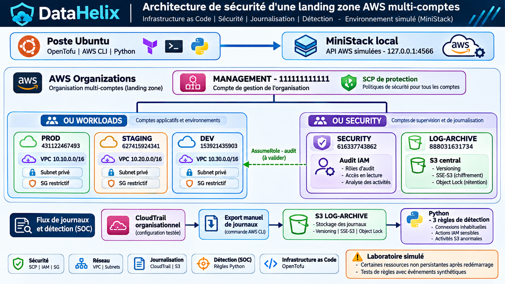
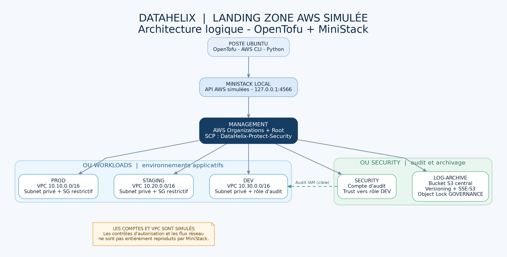
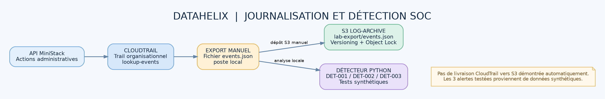

# Architecture technique - DataHelix

## 1. Vue d'ensemble

DataHelix est une **Landing Zone AWS multi-comptes simulée en local**. OpenTofu décrit les ressources et MiniStack expose les API AWS sur `http://127.0.0.1:4566`.

Vue technique modifiable : 

- **Management** - administration d'AWS Organizations, gouvernance et configuration du Trail.
- **OU Workloads** - trois comptes applicatifs isolés : PROD, STAGING et DEV.
- **OU Security** - un compte SECURITY pour l'audit et un compte LOG-ARCHIVE pour les journaux.
- **Audit inter-comptes** - un rôle en DEV est destiné à la consultation réseau depuis SECURITY.
- **Journalisation** - un Trail organisationnel est configuré et les événements sont exportés manuellement vers S3 dans ce laboratoire.

Le schéma est une vue logique : les comptes et réseaux sont **simulés**. Il ne prouve ni l'application réelle de toutes les SCP/IAM ni l'isolation de flux réseau sur AWS.

Versions réutilisables du schéma : [SVG](diagrams/architecture.svg) - [PNG](diagrams/architecture.png) - [source Graphviz](diagrams/architecture.dot).

## 2. Organisation des comptes

| Compte | OU | Fonction | Ressources principales |
| --- | --- | --- | --- |
| Management | Root | Gouvernance | Organizations, SCP, Trail |
| PROD | Workloads | Production | VPC, subnet privé, Security Groups |
| STAGING | Workloads | Préproduction | VPC, subnet privé, Security Groups |
| DEV | Workloads | Développement | VPC, subnet privé, rôle d'audit |
| SECURITY | Security | Audit | Identité de confiance pour le rôle DEV |
| LOG-ARCHIVE | Security | Archivage | Bucket S3 et protections des journaux |

Les identifiants numériques de la première exécution figurent dans la [procédure](PROCEDURE.md) à titre d'exemples. **Ils ne sont pas universels** : lors d'une reproduction, utiliser ceux renvoyés par `tofu output`.

La SCP `DataHelix-Protect-Security` est destinée à restreindre les opérations sensibles sur CloudTrail et la sortie de l'organisation. Sa présence et sa structure ont été vérifiées, mais son application complète par MiniStack n'a pas été démontrée.

## 3. Réseaux applicatifs

| Environnement | VPC | Subnet privé | Politique prévue |
| --- | --- | --- | --- |
| PROD | `10.10.0.0/16` | `10.10.1.0/24` | Security Groups restrictifs |
| STAGING | `10.20.0.0/16` | `10.20.1.0/24` | Security Groups restrictifs |
| DEV | `10.30.0.0/16` | `10.30.1.0/24` | Security Groups restrictifs |

Le module `infra/network/modules/vpc-baseline/` est réutilisé dans les trois comptes. Il configure un VPC, un subnet privé, un Security Group dédié et le groupe par défaut du VPC. Les règles sont déclarées sans autorisation entrante ou sortante. Les ressources ont été créées et vérifiées avant un redémarrage imprévu, mais **aucun test de trafic réseau réel n'a été réalisé**.

## 4. Chaîne de journalisation et de détection

1. Des appels API sont réalisés dans MiniStack.
2. `lookup-events` récupère des événements disponibles dans le service CloudTrail simulé.
3. Un export **manuel** produit `evidence/cloudtrail/events.json`.
4. Le fichier peut être chargé dans S3 sous `lab-export/events.json`.
5. Un détecteur Python analyse les fichiers JSON locaux et signale trois familles d'opérations sensibles.

| Règle | Type d'événement de test | Niveau |
| --- | --- | --- |
| DET-001 | `StopLogging` | CRITICAL |
| DET-002 | `UpdatePolicy` | HIGH |
| DET-003 | `DeletePublicAccessBlock` | HIGH |

Les trois alertes présentées dans le projet proviennent **d'événements synthétiques**. Les premiers événements collectés dans MiniStack (consultations API) n'ont produit aucune alerte. La livraison **native** de CloudTrail dans S3 n'a pas été démontrée.

Schéma du flux : [SVG](diagrams/flux-journaux.svg) - [PNG](diagrams/flux-journaux.png) - [source Graphviz](diagrams/flux-journaux.dot).

## 5. Stockage et protection des preuves

Le bucket LOG-ARCHIVE est configuré avec le versioning, le chiffrement déclaré SSE-S3 (`AES256`), le blocage des accès publics et une politique de service CloudTrail.

Une configuration Object Lock en mode `GOVERNANCE` avec une rétention de sept jours a également été déployée. Lors du test, MiniStack a refusé la suppression définitive d'une version protégée (`AccessDenied`). Le mode GOVERNANCE autorise cependant un contournement dans certaines conditions; ce test ne démontre donc pas une protection absolue.

## 6. Périmètre des validations

| Domaine | Ce qui a été observé | Ce qui reste une limite |
| --- | --- | --- |
| Organizations | Six comptes simulés créés | Pas de véritables comptes AWS |
| IAM / SCP | Politiques et rôle créés | Autorisation effective non entièrement démontrée |
| VPC | Trois VPC et règles déclarées | Pas de trafic réel testé |
| CloudTrail | Trail actif et événements consultables | Couverture multi-comptes et livraison native non prouvées |
| S3 | Objet exporté et protections configurées | Chiffrement physique sur disque non vérifié |
| Object Lock | Suppression de version test refusée | Pas de test de contournement GOVERNANCE |
| Persistance | Certains services restaurés | Trail, VPC et Object Lock perdus après reboot inattendu |

Pour reproduire le laboratoire : [PROCEDURE.md](PROCEDURE.md). Pour les résultats et écarts : [SECURITY-REPORT.md](SECURITY-REPORT.md).
