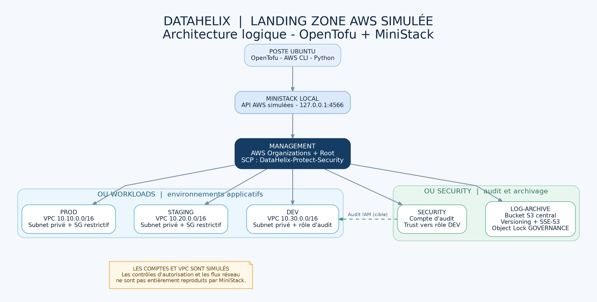
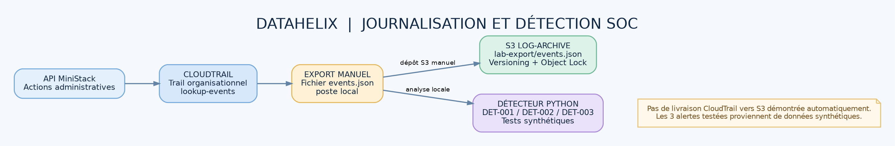

# DataHelix - Landing Zone AWS multi-comptes

Projet de Cloud Security et DevSecOps réalisé sur Ubuntu avec **MiniStack**, **OpenTofu**, **AWS CLI**, **Python**, **Checkov** et **Trivy**.

L'objectif est de construire une Landing Zone AWS simulée, de séparer les environnements, de centraliser les événements de sécurité et de vérifier les configurations par du code et des tests.

> Ce laboratoire tourne en local. Il n'utilise pas de comptes AWS réels. Certaines fonctions de MiniStack sont simulées ou ne persistent pas après un redémarrage brutal. Les résultats présentés correspondent aux tests effectués pendant le projet, pas nécessairement à l'état actuel de l'émulateur.

## Architecture



L'organisation comprend un compte Management et cinq comptes membres répartis entre deux unités organisationnelles : **Workloads** (PROD, STAGING, DEV) et **Security** (SECURITY, LOG-ARCHIVE).

La chaîne de journalisation et de détection est présentée séparément pour rester lisible :



Le schéma d'ensemble, les rôles de chaque compte et les limites de l'émulateur sont détaillés dans [ARCHITECTURE.md](ARCHITECTURE.md). Les fichiers sources `.dot` permettent de modifier les diagrammes.

## Ce qui a été réalisé

- AWS Organizations : un compte de management et cinq comptes membres (PROD, STAGING, DEV, SECURITY et LOG-ARCHIVE).
- Deux unités organisationnelles et une SCP de protection des opérations CloudTrail.
- Rôle `DataHelix-SecurityAudit` dans DEV pour les opérations de lecture réseau.
- Trois VPC et trois sous-réseaux privés avec des Security Groups restrictifs.
- Bucket central `datahelix-log-archive-888031631734` : versioning, configuration SSE-S3 et blocage des accès publics.
- Politique S3 autorisant le service CloudTrail, sous conditions, à livrer des journaux sur une architecture AWS cible.
- Trail `DataHelix-Organization-Trail` : organisationnel, multirégion, journalisation déclarée active.
- Export **manuel** d'événements CloudTrail MiniStack vers `lab-export/events.json` dans S3.
- Détecteur Python de trois familles d'événements sensibles, testé avec un jeu d'événements synthétiques.
- Object Lock en mode GOVERNANCE sur 7 jours : refus observé d'une suppression de version protégée.
- Audits IaC avec Checkov et Trivy.

## Résultats observés

| Test | Résultat |
| --- | --- |
| Comptes | 6 comptes simulés actifs |
| Trail | Création réussie, `IsLogging: true` avant redémarrage |
| Événements | `ListAccounts`, `POST.sts`, `ListBuckets` observés |
| Export S3 | `lab-export/events.json` présent, 4 294 octets lors du test |
| Détection sur événements normaux | 3 événements, 0 alerte |
| Détection sur événements synthétiques | 3 événements, 3 alertes |
| Object Lock | Suppression d'une version protégée refusée (`AccessDenied`) |
| Checkov | 69 PASS, 15 FAIL - 82,1 % brut |
| Trivy | 286 PASS, 7 FAIL - 97,6 % brut |

Les taux sont ceux des scanners. Ils ne prouvent pas que chaque contrôle est applicable ou effectivement appliqué par MiniStack.

## Organisation du dépôt

```text
infra/
  organizations/    - comptes, OU et SCP
  iam-dev/          - rôle et autorisations d'audit
  log-archive/      - bucket S3, politique, Object Lock
  cloudtrail/       - Trail organisationnel
  network/          - VPC, subnets et Security Groups
    modules/vpc-baseline/
scripts/
  detect_cloudtrail.py
tests/
  test_scp.py
  fixtures/
evidence/
  cloudtrail/
  detection/
  object-lock/
  security-scans/
docs/
  limitations-ministack.md
  GUIDE-LECTEUR.md
diagrams/
  architecture.png, architecture.svg, architecture.dot
  flux-journaux.png, flux-journaux.svg, flux-journaux.dot
PROCEDURE.md
ARCHITECTURE.md
SECURITY-REPORT.md
```

Le **code OpenTofu** du dépôt est la source de vérité pour les ressources à créer. Ce pack documentaire seul ne contient pas les modules `.tf` du laboratoire. Pour publier un dépôt complet, ajouter les fichiers `infra/`, `scripts/`, `tests/` et les preuves partageables après contrôle des données sensibles. Voir [GUIDE-LECTEUR.md](docs/GUIDE-LECTEUR.md).

## Lire et réutiliser le projet

Le dépôt est conçu pour être lisible sans connaître son historique : commencer par le schéma, poursuivre avec les validations, puis suivre la procédure si le code du laboratoire est disponible. **Les identifiants de comptes et de bucket mentionnés sont des exemples issus d’une exécution locale**, à remplacer lors d’un nouveau déploiement.

## Refaire le laboratoire

Voir [PROCEDURE.md](PROCEDURE.md). Le parcours est organisé pour tenir sur **une journée de travail** si les outils sont installés, les dépendances sont disponibles et MiniStack démarre correctement. En cas de problème de compatibilité ou de persistance, conserver les preuves et suivre les consignes de dépannage plutôt que détruire les ressources.

## Sécurité et limites

- MiniStack n'est pas AWS réel. Certaines politiques peuvent être enregistrées sans être réellement appliquées.
- L'export CloudTrail vers S3 a été manuel. Aucune livraison native de journaux S3 n'a été démontrée.
- Les trois alertes SOC ont été validées avec des événements synthétiques. Les événements réels observés n'ont généré aucune alerte.
- Le mode Object Lock GOVERNANCE admet un contournement autorisé. Le test prouve seulement le refus de la suppression ordinaire de la version testée.
- Après un redémarrage inattendu, CloudTrail, EC2/VPC et la configuration Object Lock ont disparu alors que Organizations, IAM et S3 étaient toujours présents. Voir [docs/limitations-ministack.md](docs/limitations-ministack.md).
- Les états OpenTofu, dossiers de persistance, clés et éventuels secrets ne doivent pas être publiés sur GitHub.

## Compétences

Cloud Security - AWS Organizations, IAM, SCP, VPC, S3 et CloudTrail.

DevSecOps - OpenTofu, analyse IaC, modules réutilisables et reprise d'infrastructure.

SOC / Blue Team - collecte de journaux, détection Python et preuves d'investigation.

GRC - revue des écarts, limites des contrôles et documentation d'audit.
